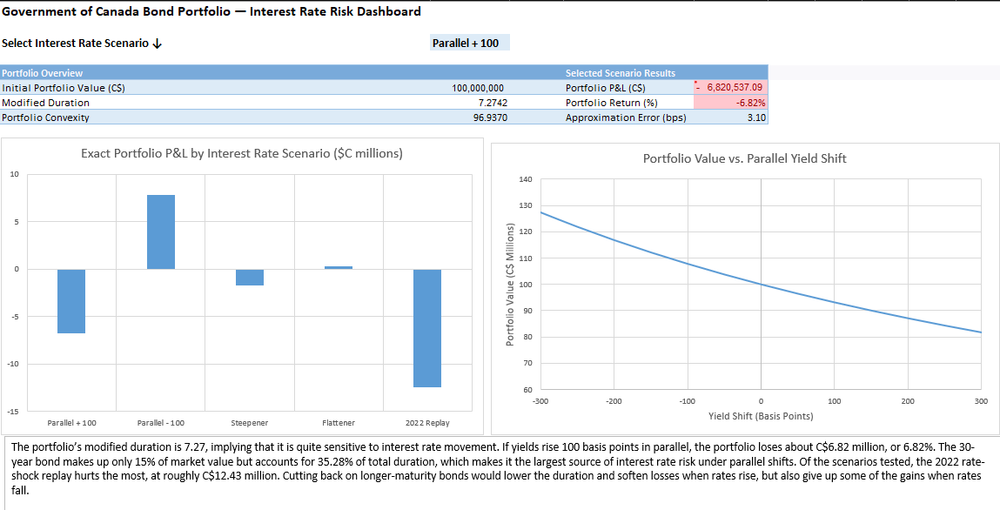

# Bond Portfolio Interest Rate Risk Analysis

Built an Excel model to assess how interest rate changes affect a hypothetical C$100 million Government of Canada bond portfolio. Combines bond valuation, duration and convexity analysis, yield curve stress testing, and an interactive dashboard to quantify potential portfolio gains and losses.

## Portfolio Setup

| Bond maturity | Portfolio weight |
|---|---:|
| 2 years | 15% |
| 5 years | 25% |
| 7 years | 20% |
| 10 years | 25% |
| 30 years | 15% |
| **Total** | **100%** |

The model uses Government of Canada benchmark yields observed on **October 29, 2026**. Each hypothetical bond has a C$100 face value and semiannual coupons. Coupon rates are set equal to initial yields so the bonds begin at par.

## Methodology

- **Bond pricing:** Discounted coupon and principal payments to determine bond values at different yields.
- **Interest rate sensitivity:** Calculated bond-level and portfolio-level modified duration and convexity, including each bond's contribution to portfolio duration.
- **Stress testing:** Repriced the portfolio under ±100-basis-point parallel shifts, yield curve steepening and flattening, and a scenario based on 2022 yield increases.
- **Model validation:** Compared duration–convexity P&L estimates with exact bond repricing to assess approximation error.

## Key Results

| Interest rate scenario | Exact portfolio P&L | Portfolio return |
|---|---:|---:|
| Parallel +100 bps | -C$6.82M | -6.82% |
| Parallel -100 bps | +C$7.79M | +7.79% |
| Steepener | -C$1.77M | -1.77% |
| Flattener | +C$0.32M | +0.32% |
| 2022 yield-change replay | -C$12.43M | -12.43% |

- **Portfolio modified duration:** 7.27 years, indicating meaningful exposure to interest rate changes.
- **Risk concentration:** The 30-year bond makes up **15% of portfolio value** but contributes **35.28% of total portfolio duration**.
- **Approximation accuracy:** Duration–convexity estimates had a **0.47% mean absolute relative P&L error** versus exact repricing across the five scenarios.

## Excel Dashboard

The dashboard includes a scenario selector, portfolio risk metrics, exact scenario P&L comparisons, a portfolio value sensitivity chart, and a summary of key findings.

